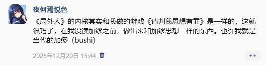

**原标题:不转发、不站队、不共情：在集体狂欢中，做个“局外人”错了吗？**

我是怎么看《局外人》的呢？我第一次听说这本书是在高一，惭愧的是我到大一才读完。在我看来，他最核心的话题其实和我参加“秒哒杯”时做的小游戏《请判我思想有罪》是一样的。没错，就是“思想罪”。

“思想罪”在文学上最早应该是奥威尔写的《1984》。在《1984》中“思想罪”被定义为“想了不该想的”，而在历史上，我国古代的文字狱也可以被视为思想罪的一种，甚至最早可以追溯到中世纪宗教对异端思想的审判。那默尔索为什么会被判“思想罪”呢？只是因为他没有在母亲的葬礼上哭吗？我想不是的。

这起枪击案会发生，只是因为那时的阳光。这种完全外在的感官感受成了法官不断追问的细节。为什么枪杀阿拉伯人？为什么在开了一枪后停顿了一下又开了三枪？但是随着案件的深入调查，对默尔索的审判已经从杀人到思想有错，完全偏离了初衷。而一个在母亲的葬礼上没有哭的人，是社会秩序不容的“异类”，这也是默尔索作为局外人的一个体现。他自始至终都没有对进入“社会”表现出多大的热情，仿佛自己是一个社会之外的人。而默尔索的局外性还表现在庭审时，他“无法说话”。我们可以这么说，是因为默尔索是一个“局外人”，于是被判死刑。系统不允许有不受控制的人。

那默尔索的“思想罪”表现在什么地方呢？

最突出的地方就体现在他的“不孝”。他不记得母亲的具体岁数，把母亲送到养老院，不看母亲的尸体，这些行为都不符合社会对“好人”的定义。但是在我看来，莫尔索是爱他母亲的，只是形式不同，他认为母亲在养老院比呆在自己你身边更开心，因为他们两个人没有话说，而养老院有很多老人，此外还能节省开支。他虽然不记得母亲的具体年龄，但是他记得母亲说过的话，还有他讲的父亲的故事，莫尔索只是在用他的方式爱着母亲，只是这种方式和社会的规范不一样。

此外，他在面对神父时并不忏悔也是他犯的“思想罪”。第一次神父出现是在母亲的葬礼，而第二次是默尔索自己面对死亡，。面对神父的谆谆教诲，穆尔索反而觉得很烦，而他最后和神父的辩论，在我看来，是对系统最彻底的质问，是全书最精彩的地方。

而他犯的第三个“思想罪”是他拒绝去巴黎。一般世人面对升职，应该会感到兴奋，就像玛丽一样，但莫尔索却兴致缺缺，反而对玛丽说巴黎很差。他对玛丽不是为了爱的婚姻也是一个“思想罪”。

归根结底，默尔索犯下的“思想罪”是“真实”，他拒绝为了迎合社会的道德秩序而撒谎，这种对“真实”的坚持被威权视为异端。

默尔索是一个虚无的人，过着没有意义的人生，但他其实比任何人都过的有意义。社会是一场大家共同参与的“表演”，而默尔索拒绝了。他实际上直面了虚无，比社会上那些试图以“表演”来逃避的人活的更彻底。默尔索是死了的，但是其他人根本没有活过。

他知道人生是虚无的，因此他只在乎感官感受活在当下，而他反抗虚无的方式，就是“承认”。在结尾，默尔索希望他行刑那天，有很多人围观，就体现了默尔索的反抗。加缪在《西西弗神话》中写：“藐视可以克服任何命运。”对于他来说，如果他低头忏悔，他就重新回到了社会的道德框架里，他希望人们围观并仇恨，是因为这种仇恨证明了他是一个真正的异端，反而成了莫尔索确定自己存在的纽带。

但总的来说，默尔索的反抗是消极的。后来加缪在《西西弗神话》和《鼠疫》中则强调了积极的反抗，换句话说，局外人是加缪哲学的起点，并不完善。

而另一个值得我们讨论的是，默尔索确实杀人了，他无疑是一个杀人犯。以杀人犯为主角，有时会让一些读者认为加缪在为杀人犯开脱，但事实并非如此。

在法律上，杀人罪的判定通常依赖动机。默尔索的动机是“阳光”，但这是不能接受的，他们必须给莫尔索编造一个动机。系统为了消灭一个杀人犯，即使编也要定罪。这么来看加缪其实在歌颂系统（笑）。但其实并不是这样，这是从实用主义角度出发得出的结论，但是这忽略了程序正义。

在加盟那个年代，系统会为一个思想有罪的人定罪，而在今天也不例外。

如果你在某个公共悲剧发生时，你不和别人一样转发哀悼，或者发了很喜庆的东西，你就可能面临“道德审判”。而社会要求你必须对特定话题表达“愤怒”、“同情”等情绪化心理，如果你不那样做，你就会被贴上“冷血”、“三观不正”的负面标签。现在社会的思想罪是强制你参与集体的感情共振，就像澳大利亚那起林迪•张伯伦案。

互联网的兴起无疑是加强了思想罪。在社交媒体中我们其实经常看到：“你不同意a，你就是支持b！”“你现在为这件事发声，为什么以前不为那件事发声。”“”看看你的成分，释然了。”而更厉害的地方在于，人们常常使用“标签化定罪”：因为某个观点，某人被贴上了“圣母”“小粉红”之类的标签。此后，他的一切言论都将通过这些标签被解读。

或者说像默尔索在葬礼上的行为被法官翻出，现代人通过“挖坟”、“考古”等来寻找某个人的社交媒体历史、早年言论，并脱离具体语境，构建一个“一贯如此”的负面形象，用来否定他现在的所作所为。

而默尔索的局外人状态在今天也屡见不鲜，信息茧房是一个很好的例子。不同观点的人无法相互理解，都觉得对方不可理喻，而复杂的议题在传播中被简化为口号的站队，像默尔索那样拒绝一边站的人被视为“洗地”“矫情”。

《局外人》给我们的最大启示就是拒绝“表演”。我们得承认有些悲剧我们就是无法感同身受，有些宏大叙事我们就是不感兴趣。与其去想“我应该如何表现”，不如把注意力回归当下，去感受现在我是什么感受。

但是我们不能完全变成默尔索，他的“真实”带有一种机械性，他杀人是因为阳光，这说明他完全受控于本能，缺乏对他人的共情。而我们应该在不伤害他人的底线上拒绝向虚伪的道德仪式交出灵魂。

当你意识到世界是荒谬的，你反而获得了真正的自由。

# 后记（2026.5.19）

在这篇文章关于思想罪的讨论之前，诞生了迄今为止我最喜欢的一个标题：**请判我思想有罪**。当时应该在做秒哒杯，因为我的人工智能课程成绩很高，于是被老师叫去参加秒哒杯了，最后也是得了一个一等奖。后来我也有几次用过秒哒，那就是后话了。

那个应用的标题，就叫“请判我思想有罪”，链接放在这里了：https://app-83e5wt7m6b5s.appmiaoda.com/