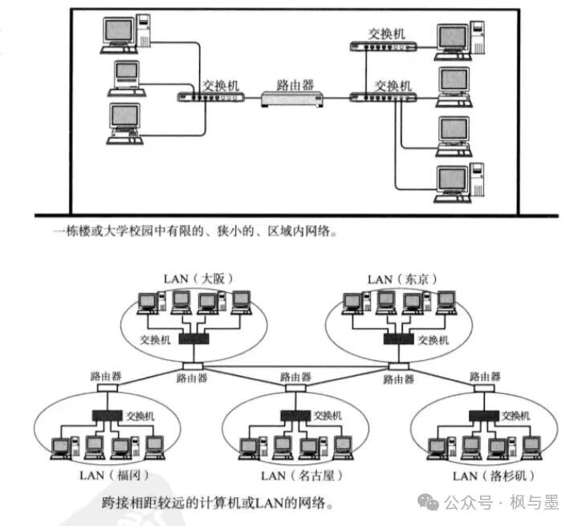

<!-- markdownlint-disable MD033 -->
“20世纪最伟大的发明就是计算机！”
<!-- markdownlint-enable MD033 -->

计算机如今已成为了我们生活中不可或缺的一部分，对我们的工作和生活产生了深远的影响。从工厂，学校，办公室，研究室到家庭个人电脑，手机，平板电脑，甚至连家用电器，汽车等也会内置小型芯片拥有计算机控制功能，计算机越来越普及。在不经意之间，我们的生活已与计算机相连，而这些之中的绝大多数都具有联网功能。

起初，计算机以单机模式(独立模式)被广泛使用，随着计算机的发展，人们不再局限于单机模式，而是将计算机连接，形成一个个计算机网络。连接多台计算机可以实现信息共享，较远距离的信息传递。

计算机网络按照覆盖范围可分为WAN和LAN，即广域网和局域网，也有一种处于两者之间，连接整个城市的城域网，MAN。

最初的计算机网络是一种私有网络，管理员将特定的几台计算机连接形成计算机网络。例如将同一个公司，同一个研究所，或者有业务往来的公司之间的计算机连接到一起。

随着私网的不断发展，人们又将私网相连组成更大的私网，这种私网又逐渐演变成互联网供全世界使用。在这一过程中，网络环境俨然发生了翻天覆地的变化。

一台计算机接入互联网后，便不再局限于公司或部门内部的通信，而是能够和世界上任何一台接入互联网的计算机通信。互联网作为一种新兴的通信手段，大大丰富了当时人们的通信体验。

此后，人们不断研发各种互联网接入技术，使得各种通信终端都能够连接到互联网，使互联网成为一个世界级的计算机网络，形成了现在综合通信的局面。

世界各地的信息通过网络传递到每个人的计算机之中。随着互联网的快速发展与普及，信息网络已随处可见。邮件组、主页、BBS，网络日志，聊天室，即时通讯，SNS都是当时的产物，而有些直到现在依然在使用。

对于二十年前的人们来说，互联网并不像现在这样触手可及，甚至拥有一台计算机都不是一件容易的事。

***据《图解TCP/IP》（第五版）第一章 网络基础知识1.1计算机网络出现背景  整理。***

# 后记（2026.05.17）
这是我第一篇公众号，当时是打算跨考计算机硕的，但是学不下去啊，就想了一个办法，是我早些年在网上看到的*费曼学习法*，然后我突发奇想，建立了一个公众号，想着给自己一个更新压力，好让自己能够去学计网，虽然看的不是教材，结果最后就更了没几章，不是我不更新了，是我不学计算机了，因为我发现了工商管理也有一条通天大道，于是这个 *“编织世界”* 的栏目就没更新了。

对于我来说，书读一半和不读没区别，所以以后肯定是会继续更新的。~~就是不知道什么时候了~~