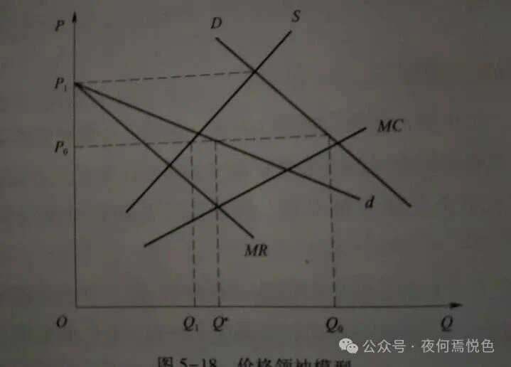

# 引言:

家住美国的小李去壳牌加油站加油，他习惯性的看了一眼价格牌，油价又上涨了，他又开车来到埃克森美孚，发现油价竟然和壳牌的一样，他不信邪般又去了几个加油站，无一例外，全是一个价格。
小李加完油回家，带着疑惑上网了解到原来由于国际原油价格上涨，本地炼油厂供给各大加油站的批发价已经上调。令人惊讶的是，在埃克森美孚宣布涨价以后其他公司也纷纷宣布加价，小李隐约感觉其中似乎另有玄机。

# 一、价格领袖是什么

有这样一种市场:在该市场中，存在一个具有支配地位的大企业和一群不具有支配地位的小企业。改变价格的决定总是由居支配地位的大企业作出，其他小企业则紧随其后，即跟随大企业同时和同等程度地改变价格。

在这种情况下，大企业就是所谓的“价格领袖”。它率先制定一个市场价格，其余小企业则接受并跟随这一价格。

价格领袖通过确立一个统一的、可预测的价格，来避免破坏性的竞争，从而使得市场中的主要企业（尤其是领袖自身）能够实现并维持长期利润的最大化。

# 二、什么样的寡头当价格领袖

价格领袖主要分为三类，分别是支配型，效率型，和晴雨表型，由于寡头垄断市场的特征，不论是哪种价格领袖，其价格都是相当稳定的。寡头企业的相互联系，导致在价格领袖制下，一旦价格被设定，就会在一段时期内保持相对稳定。
在支配型价格领袖中，市场份额最大的企业拥有定价权。
在效率型价格领袖中，成本最低的企业拥有定价权。
在晴雨表型价格领袖中，对市场敏感度最高的企业拥有定价权。

如图，D 代表市场需求曲线，S 是所有小企业的供给曲线（即所有小企业的边际成本曲线的水平相加）。在每一价格水平上，D 与 S 的水平差距是寡头企业准备提供的产量。例如，当价格为 P0时，市场的需求量为Q0，所有小企业提供的总供给量为 Q1 ，支配性企业面临的“剩余”需求量为 (Q0−Q1)=Q*。D与S水平相减后得到的d是寡头企业面临的需求曲线。根据需求曲线d，支配性企业的边际收益曲线为MR。MR与边际成本曲线MC的交点决定了支配性企业的利润最大化产量为Q*，相应的利润最大化价格为P0

# 三、为什么会产生价格领袖

什么样的市场会产生价格领袖呢？
1、存在一个明显的“强者”，为其他企业提供了跟随的理由和对象。
2、产品同质化高。如果产品高度同质，消费者只关心价格，那么任何企业的私自降价都会立刻抢走大量客户，从而导致隐形合谋破裂，陷入价格战，最终两败俱伤。反之，统一价格就变得顺理成章。
3、市场透明度高，任何价格的细微变化都能迅速发现，并及时跟随。
4、进入壁垒高，如果壁垒过低，就不容易产生寡头，市场趋向于完全竞争。只有存在高门槛，潜在竞争者才难以进入，从而维持市场的稳定结构。

虽然所有企业都遵循MR=MC的利润最大化原则，但这并不能决定寡头垄断市场必然出现价格领袖。价格领袖制只是寡头企业在相互依存的市场结构中，为了规避竞争不确定性、实现稳定利润而可能选择的一种策略性行为。

在寡头市场中，合作比竞争更有利，如果每个企业都独立地追求短期利润最大化，会引发价格战，最终导致所有企业利润受损，形成囚徒困境，导致“双输”局面。而通过合作
，大家都能获得稳定长期的利润。

另外，组建卡特尔在大多数国家是违法行为，而价格领袖是一种完美的替代方案。它是一种隐形合谋，它不需要正式的会议、合同或握手。 它通过长期的市场互动形成一种默契。领袖企业率先发出价格信号，其他企业通过跟随来表示同意。这种模式既达到了合谋的效果，又规避的法律风险。

# 四、价格领袖模型的价值与缺陷

规价格领袖模型的价值在于它描绘了一种摆脱“囚徒困境”、实现隐性合作、稳定市场的巧妙方式。它是理解许多现实世界寡头行业（如石油、钢铁、航空等）定价行为的关键。

然而，它的缺陷揭示了这种合作本质上是脆弱和不稳定的。它依赖于领袖企业的正确判断、跟随者的自律、以及一个相对稳定的市场环境。一旦这些条件被打破，合作就会瓦解，市场将重回竞争状态。

因此，价格领袖模型最好被看作是寡头市场动态博弈中的一个可能出现的、但并非永久的均衡状态。

# 五、结语

油价的同步上涨，看似是几家加油站间的默契，实则反映了市场内部的力量结构。价格领袖并非简单的操纵者，而是市场理性与集体行为之间微妙平衡的产物。
在这种秩序中，大企业的定价既像一种“号角”，也像一种“约束”——它发出信号，其他企业则用跟随回应，从而维持了市场的稳定。

或许，这正是经济世界的一种哲学隐喻：真正的秩序，并不总来源于强制，而往往源于众人对某种信号的共同信任。当每一个个体都在理性地选择跟随，市场这台庞大的机器也就开始有了自己的节奏。

小李在加油站看到的，不只是油价的数字，更是市场自发协调的力量——一种看不见，却真实存在的“领袖之手”

# 后记（2026.05.17）
~~其实我是文科生~~
这个是我们上学期的经济学小组作业的视频文案，其实我还是支持计划经济中的市场经济的，计划经济太先进了，得用市场经济这个有缺陷模型来运作，毕竟我们现在还做不到真的完全计划，而市场是一个**看不见的大手**~~(哈耶克万岁！)~~，它可以调控，不过随着生产力的发展，计划经济是必然的。其实经济学界和政策界一直在探索所谓的**第三条道路**。价格机制在信息发现和激励方面有不可替代的作用，但市场失灵也需要计划和监管来纠正。两者不是非黑即白，更可能是光谱的两端，现实的经济体制大多位于中间某个位置。而现在有的企业内部也会局部实行计划经济的，罗纳德·科斯（Ronald Coase）的 **企业的本质** 理论就指出，企业之所以存在，就是用内部的“命令和计划”取代了外部的“市场价格机制”，从而节省交易成本。但企业无法无限扩大，因为内部管理成本也会随之上升。这个边界，就是市场和计划力量的均衡点。